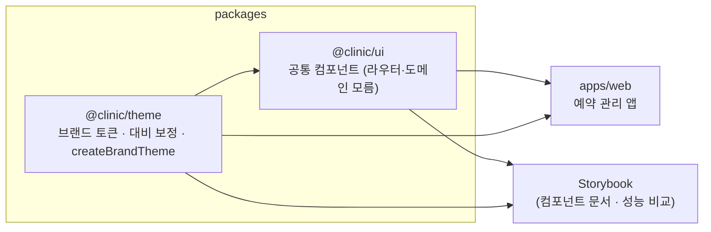
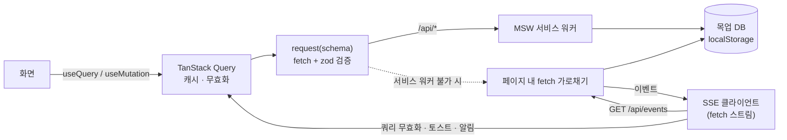

# 케이스 스터디 — 구조와 문제 해결 기록

이 프로젝트를 만들며 실제로 부딪힌 문제를 **문제 → 원인 → 선택지 → 결정 → 검증** 순서로 정리했습니다.
대부분 테스트(단위·E2E·접근성 검사·성능 측정)가 먼저 찾아냈고, 고친 뒤에는 같은 문제가 다시 생기지 않도록 회귀 테스트를 남겼습니다.

## 구조

### 패키지

- **테마**: 고객사 브랜드 가이드 → `BrandTokens` → `createBrandTheme()` → MUI 테마(CSS 변수). 새 고객사는 토큰 파일만 추가 ([측정 기록](brand-onboarding.md))
- **공통 컴포넌트**: 라우터를 모른다. 앱이 테마의 `LinkComponent` 로 React Router 링크를 주입
- **앱**: 도메인(zod 스키마·상태 전이 규칙), API 훅(TanStack Query), 화면

### 데이터 흐름

## 1. 명도 대비 "4.49 를 4.5 로" 통과시키던 MUI 함수

|                 |                                                                                                                                                                                                                                                                                 |
| --------------- | ------------------------------------------------------------------------------------------------------------------------------------------------------------------------------------------------------------------------------------------------------------------------------- |
| **문제**        | 테마 단위 테스트는 모든 색이 WCAG AA(4.5:1)를 통과했는데, E2E 의 axe 검사는 온결피부과 버튼 글자 대비를 4.49 로 판정해 실패                                                                                                                                                     |
| **원인**        | MUI `getContrastRatio()` 는 내부에서 휘도(`getLuminance`)를 **소수점 셋째 자리로 반올림**한 뒤 대비를 계산한다. 이 오차 때문에 온결피부과 로즈색(`#B4536A`)과 배경(`#FBF7F4`)의 대비가 실제 **4.4943** 인데 MUI 로는 **4.5023** 으로 계산되어 "기준 통과"로 판정, 보정이 멈췄다 |
| **추가로 발견** | 같은 색이 **브랜드 배경(옅은 색) 위 글자**, **soft 버튼의 반투명 배경 위 글자**로도 쓰이는데, 흰 배경 기준으로만 보정하고 있었다                                                                                                                                                |
| **결정**        | 대비 계산을 직접 구현(정수 RGB 반올림까지 브라우저와 동일하게)하고, 색이 실제로 놓이는 **모든 표면**을 기준으로 보정. 반투명 배경은 표면과 합성한 실제 색으로 계산                                                                                                              |
| **검증**        | 경계값 회귀 테스트(`#B4536A` on `#FBF7F4` = 4.48~4.5), 모든 고객사 × 라이트/다크 × 색 6종 × 표면별 대비 테스트, E2E axe 위반 0건                                                                                                                                                |

## 2. 첫 Tab 이 "본문 바로가기"를 건너뛰던 문제 (React StrictMode)

|          |                                                                                                                                                                      |
| -------- | -------------------------------------------------------------------------------------------------------------------------------------------------------------------- |
| **문제** | 개발 모드에서만, 첫 화면에서 Tab 을 누르면 "본문 바로가기" 링크가 아니라 그 다음 요소로 포커스가 갔다                                                                |
| **원인** | 페이지 이동 시 본문으로 포커스를 옮기는 effect 가 "첫 렌더면 건너뛰기" 플래그를 썼는데, StrictMode 가 effect 를 두 번 실행해 두 번째 실행에서 포커스가 본문으로 이동 |
| **결정** | 플래그 대신 **이전 경로와 비교**해 실제로 경로가 바뀌었을 때만 포커스 이동 (StrictMode 의 이중 실행에도 결과가 같은, 멱등한 effect)                                  |
| **검증** | E2E: 첫 Tab 이 본문 바로가기 링크, 통합 테스트: 메뉴 이동 시 본문 포커스                                                                                             |

## 3. 목업 API 가 없을 때 화면에 zod 원문 오류가 나오던 문제

|          |                                                                                                                                                                                                                |
| -------- | -------------------------------------------------------------------------------------------------------------------------------------------------------------------------------------------------------------- |
| **문제** | 일부 브라우저(앱 내장 브라우저 등)에서 `데이터를 불러오지 못했습니다. [{"expected":"array","code":"invalid_type"...}]` 가 그대로 노출                                                                          |
| **원인** | 서비스 워커 등록이 막혀 목업 API 가 꺼짐 → `/api/*` 요청을 개발 서버가 SPA 대체 페이지(index.html, **200 OK**)로 응답 → JSON 파싱 실패가 `null` 로 삼켜짐 → zod 검증 오류 원문이 사용자에게 노출               |
| **결정** | ① 응답 `Content-Type` 이 JSON 이 아니면 200 이어도 실패로 처리 ② 실패 종류별로 사용자용 문장으로 바꾸고 상세 원인은 콘솔에만 ③ 서비스 워커를 쓸 수 없으면 **페이지 안에서 fetch 를 가로채는 대체 모드**로 전환 |
| **검증** | `request()` 단위 테스트 6개(HTML 응답, 형식 오류, 서버 오류 메시지, 네트워크 오류, 취소), 서비스 워커를 막은 브라우저에서 동작 확인                                                                            |

## 4. 실시간 알림: Safari 에서 멈추는 SSE

|            |                                                                                                                                                                                                                                 |
| ---------- | ------------------------------------------------------------------------------------------------------------------------------------------------------------------------------------------------------------------------------- |
| **문제**   | 실시간 알림을 SSE 로 만들 때, 백엔드 없이 목업 서버로 스트림을 흉내 내야 했다                                                                                                                                                   |
| **원인 1** | 브라우저 `EventSource` 는 fetch 를 거치지 않아, 대체 모드(페이지 내 fetch 가로채기)와 Node 테스트 환경에서 가로챌 수 없다                                                                                                       |
| **원인 2** | MSW 는 서비스 워커의 스트리밍 응답을 `ReadableStream` 전송을 지원하는 브라우저에서만 흘려보내고, 그 외(Safari 등)에서는 **응답 본문을 끝까지 모은 뒤** 전달 → 끝나지 않는 SSE 는 영원히 도착하지 않는다 (MSW 소스에서 확인)     |
| **선택지** | 폴링(단순하지만 실시간성 약함) / WebSocket(양방향 불필요) / **fetch 기반 SSE 클라이언트 직접 구현**                                                                                                                             |
| **결정**   | fetch 스트림을 HTML 표준 규칙대로 해석하는 SSE 클라이언트를 구현(여러 줄 data, CRLF, 주석, `retry`, 지수 백오프 재연결, `Last-Event-ID` 로 놓친 이벤트 재수신). SSE 스트림만은 서비스 워커가 아닌 페이지 안에서 가로채도록 분리 |
| **검증**   | 파서 단위 테스트(조각 경계가 줄·CRLF 중간이어도 동일), 재연결 시 `Last-Event-ID` 전송 테스트, Chromium·WebKit 에서 실제 수신 확인, E2E 알림 흐름                                                                                |
| **한계**   | Node 테스트(undici + MSW)에서 스트림을 열어 두면 다른 요청이 간헐적으로 중단되는 현상 → 알림과 무관한 통합 테스트는 실시간 연결을 끄고, 알림 테스트에서만 켠다. 브라우저에서는 재현되지 않음                                    |

## 5. 무한 스크롤이 가끔 멈추던 문제 — "취소"를 "오류"로 바꾸던 래퍼

|          |                                                                                                                                                                                                                                                            |
| -------- | ---------------------------------------------------------------------------------------------------------------------------------------------------------------------------------------------------------------------------------------------------------- |
| **문제** | 무한 스크롤 통합 테스트가 전체 실행 시에만 간헐적으로 실패(30명에서 멈춤)                                                                                                                                                                                  |
| **추적** | 로그를 단계별로 넣어 보니 다음 페이지 요청이 `서버에 연결할 수 없습니다` 오류로 끝나고, 오류 상태가 되자 "더 불러오기"가 멈췄다                                                                                                                            |
| **원인** | 스크롤 이벤트가 연달아 오면 `fetchNextPage()` 가 두 번 호출되고, 기본값(`cancelRefetch: true`)이 진행 중인 첫 요청을 **취소**한다. 그런데 공용 fetch 래퍼가 취소(`AbortError`)까지 "네트워크 오류"로 감싸 버려, TanStack Query 가 취소를 실패로 받아들였다 |
| **결정** | ① 호출한 쪽이 취소한 요청은 `AbortError` 그대로 전달 ② 무한 스크롤은 `fetchNextPage({ cancelRefetch: false })` ③ 실시간 알림으로 목록을 다시 불러오는 동안 무시된 요청은 끝난 뒤 다시 시도                                                                 |
| **검증** | 취소 회귀 테스트, 같은 테스트를 6회 연속 통과로 간헐 실패 해소 확인. 실제 브라우저에서도 빠른 스크롤 시 생길 수 있던 버그                                                                                                                                  |

## 6. 가상화했더니 스크롤이 더 느렸다 — 측정으로 찾은 성능 문제

|          |                                                                                                                                                    |
| -------- | -------------------------------------------------------------------------------------------------------------------------------------------------- |
| **문제** | 성능 측정 스크립트로 10,000행을 비교해 보니, 첫 렌더는 57배 빨랐지만 **스크롤 프레임 p95 는 가상화 표(23.6 ms)가 일반 표(18.0 ms)보다 나빴다**     |
| **원인** | 스크롤할 때마다 표가 다시 렌더링되면서, 새로 들어온 행뿐 아니라 **이미 보이던 행까지 전부** 다시 렌더링(80단계 동안 React 렌더 247 ms)             |
| **결정** | 행·카드를 `React.memo` 컴포넌트로 분리. `measureElement` 처럼 인스턴스마다 고정된 함수만 넘겨 props 가 바뀌지 않은 행은 건너뛴다                   |
| **검증** | 같은 조건 재측정: React 렌더 247 → 99 ms(2.5배 감소), 프레임 p95 23.6 → 18.8 ms(일반 표 수준). 측정 방법과 전체 결과는 [성능 측정](performance.md) |

## 그 밖에 테스트가 찾아낸 것

- **색 전환 중 대비 검사 실패**: 불러오는 동안 `disabled` 였던 버튼이 활성화되며 250 ms 색 전환이 일어나는 순간을 axe 가 측정. 데이터 준비 후 렌더링으로 고치고, 이후 CSS 변수 테마로 바꾸며 모드 전환 시 transition 을 꺼서 구조적으로 차단
- **"모두 읽음" 후 키보드 포커스 사라짐**: 누르면 `disabled` 가 되어 포커스가 body 로 빠지고 Esc 로 패널을 닫을 수 없었음 → 활성 상태 유지
- **알림 배지의 숨은 "0"**: 읽지 않은 알림이 0 이어도 DOM 에 "0" 이 남아 버튼 이름("알림")과 보이는 글자가 어긋남(Lighthouse) → 0 이면 배지 내용 비움
- **새로고침 직후 라이트 배경 깜빡임**: 앱 JS·목업 API 준비 전까지 테마가 없음 → 빌드 시 브랜드 토큰에서 배경색을 읽어 `<head>` 동기 스크립트로 미리 적용
- **모바일 Safari E2E 실패(CI 만)**: 카드 높이가 그려진 뒤 실측되며 문서 높이가 바뀌어 End 키 한 번으로 끝에 닿지 못함 → 끝에 닿을 때까지 재시도
